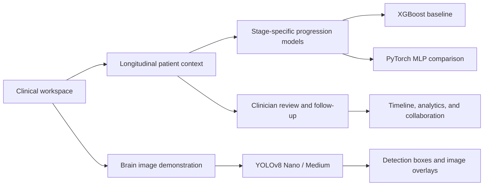

<div align="center">
  
  <h1>SMRITI</h1>
  <p><strong>Neurological care, connected by context.</strong></p>
  <p>
    A research-first clinical decision support experience bringing longitudinal
    Alzheimer's progression modeling, brain-imaging experiments, and clinician-led
    workflows into one thoughtful workspace.
  </p>
  <p>
    
    
    
    
  </p>
</div>

---

## The idea

Neurological care rarely fits into a single test or appointment. **Smriti** is a
clinical-workflow prototype designed to bring patient context, staged Alzheimer's
progression research, brain-tumor image experiments, and clinician collaboration
together in one interface.

The platform pairs a modern web dashboard with a Python API and distinct model
workflows. It is built to make complex signals easier to review—not to make
clinical decisions on anyone's behalf.

## One workspace. Two research tracks.



The progression and tumor workflows are **separate research tracks**. They do
not share labels or combine their outputs.

## What Smriti brings together

| Capability | What it does |
|---|---|
| **Four-stage progression workflow** | Organizes screening, plasma biomarkers, MRI-derived measurements, and PET-derived measurements into stage-specific workups. |
| **Model comparison** | Runs available XGBoost baselines alongside PyTorch MLP models for the same 24-month progression target. These are research estimates, not diagnoses. |
| **Per-case model context** | Returns calibrated XGBoost estimates and feature contributions to help users inspect what influenced a model output. |
| **Brain-tumor image demo** | Offers a separate YOLOv8 Nano/Medium experiment for glioma, meningioma, and pituitary detections, with bounding boxes and visual overlays. |
| **Patient workspace** | Supports patient records, stage assessments, visit history, timelines, analytics, reassessment, and clinician review. |
| **Care-team collaboration** | Includes telemedicine consultation flows with WebRTC signaling and configurable email invitations. |
| **Clinical document workflows** | Includes PDF lab-report parsing and generation of FHIR-shaped `ServiceRequest` resources. These features do not imply a verified connection to an external EHR. |
| **Population-aware interface** | Includes an optional LASI-DAD-informed cognitive-score adjustment workflow for research exploration. |

### A staged view of progression research

Each stage uses its own feature set while estimating the same prepared binary
`Progression24m` outcome. The stages are **not diagnosis classes**, and the MRI
and PET inputs in this workflow are structured measurements—not raw scan-image
inference.

| Stage | Evidence context |
|:---:|---|
| **01** | Cognitive and clinical screening |
| **02** | Plasma biomarker measurements |
| **03** | MRI-derived structural measurements |
| **04** | PET-derived molecular measurements |

The application can present the available XGBoost and MLP outputs as separate
model results. A model score is not a diagnosis, referral, or treatment
recommendation.

### A separate brain-imaging experiment

The tumor demonstration uses YOLOv8 model variants and displays detected classes,
confidence, and image-space boxes. Its JET overlay is a visualization generated
around detected regions; it is **not** a model saliency map or clinical
interpretation. An empty detection list means only that the model returned no
detections for that image.

## Designed as a connected product

```text
┌───────────────────────────────────────┐
│  Next.js · React · TypeScript         │
│  Dashboard · Workups · Consultations  │
└───────────────────┬───────────────────┘
                    │ JSON / WebSocket
┌───────────────────▼───────────────────┐
│  FastAPI application                  │
│  Auth · Patient APIs · Research APIs  │
└───────┬───────────────────┬───────────┘
        │                   │
┌───────▼────────┐  ┌───────▼────────────────┐
│ SQLite records │  │ Model and data layer   │
│ History / auth │  │ XGBoost · PyTorch · YOLO│
└────────────────┘  └────────────────────────┘
```

### Engineering highlights

- **A full-stack product surface:** Next.js App Router, React, TypeScript, and a
  responsive dashboard connected to a FastAPI backend.
- **Distinct model paths:** tabular progression models and image-detection
  experiments remain separate at the API and product-workflow level.
- **Model artifact awareness:** the API loads stage-specific artifacts and
  exposes model availability rather than assuming every artifact is present.
- **Explainability in the workflow:** XGBoost feature contributions are returned
  with progression estimates for case-level inspection.
- **Research-oriented input handling:** image uploads have file-type, size, and
  dimension checks before inference.
- **Longitudinal workflow design:** patient records, stage workups, visit history,
  timelines, review actions, and analytics live alongside—not inside—the model.

## Technology

| Layer | Tools |
|---|---|
| **Web experience** | Next.js 14, React 18, TypeScript, Tailwind CSS, Framer Motion |
| **Application API** | Python, FastAPI, Pydantic |
| **Progression research** | XGBoost, PyTorch, scikit-learn, SHAP |
| **Image experiment** | Ultralytics YOLOv8, OpenCV, Pillow |
| **Persistence and data** | SQLite, pandas, NumPy, Parquet |
| **Real-time collaboration** | WebSockets and WebRTC signaling |

## Project map

```text
Smriti/
├── frontend/       Next.js application and interface
├── backend/        FastAPI API, services, and model artifacts
├── Dataset/        Stage-specific research cohorts
├── evaluations/    Model evaluation material
├── scripts/        Data preparation and model workflows
└── tests/          Backend and research-workflow tests

presentation_images/    Research and model-visualization assets
```

## A note on responsible use

Smriti is a **research and education prototype**, not a medical device. It has
not been established as clinically valid, and its outputs must not be used to
diagnose, triage, or guide treatment. Model performance depends on the data,
cohort definitions, and evaluation behind each artifact; the presence of a model
or visualization is not evidence of clinical effectiveness.

Use synthetic or otherwise appropriately authorized data for demonstrations.
Always defer clinical decisions to qualified professionals and validated
processes.

---

<div align="center">
  <sub>Built to explore how AI, longitudinal data, and human expertise can work together in neurological care.</sub>
</div>
